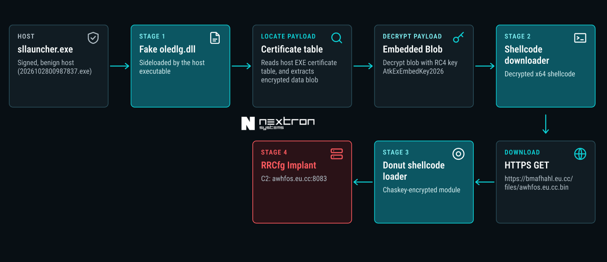

# oledlg.dll Sideloading Chain To RRCfg Implant

## 1. Executive Summary

The sample is a five-stage, multi-layer loader chain that ends in a remote-access-style implant (x64 DLL). It uses **DLL sideloading** of a fake `oledlg.dll` by a validly signed Microsoft `sllauncher.exe` (Silverlight launcher). The first stage payload is hidden in the **certificate table** of the signed EXE, so the signature appears intact. Later stages download a Donut-wrapped DLL from an attacker-controlled server, which then connects to a hard-coded command-and-control (C2) server over TCP.

- **Final C2:** `awhfos.eu.cc:8083` (TCP)
- **Stage-3 delivery host:** `bmafhahl.eu.cc`
- **Family:** Unidentified. We track is as RRCfg_Implant . The implant uses an HP-Socket-style IOCP TCP client, ECDH P-256 / AES-GCM via Windows CNG, and stores or reads its config from `HKCU\SOFTWARE\RRCfg`.
- **Final implant (Stage 4):** a modular lean beacon with a plugin loader. It profiles the host (machine GUID, computer and user name, installed antivirus via WMI), reports which processes are running, and can power off or reboot the host, change its own C2, shut itself down, or **reflectively load and run a PE plugin sent by the C2**. It has no built-in shell, file transfer, keylogging or screen capture, so its real capability depends on the plugins the operator delivers.

## 2. Infection Chain

## 3. Stage Details

### Host executable (`2026102800987837.exe`)
| Property | Value |
|---|---|
| SHA-256 | `fdb7eacc76e9e60b9aff935eb4af19155291f6ee4dd684f6ffd3691fbfb556d0` |
| Identity | Genuine Microsoft Silverlight Out-of-Browser Launcher (`sllauncher.exe` 5.1.50918.0), signed by Microsoft Corporation (cert valid 2018-07-12 to 2019-07-26) |
| Payload location | Certificate table at file offset `0x7E600`, size `0x9130`. Marker at table offset 6792; encrypted blob starts at file offset `0x80090` (30,368 bytes). |

The file is a legitimate signed binary, used only as a sideloading host and as a container for the payload.

### Stage 1: Sideloaded loader (`oledlg.dll`)
| Property | Value |
|---|---|
| SHA-256 | `0c3bfa918528b8b7e5e4c09773c22e736753e4c26ad0ba3078b1f11e8962b17a` |
| Size | 212,992 bytes, x64 PE |
| Masquerade | Microsoft "OLE User Interface Support", v10.0.19041.4355 |
| Anomalies | Extra section `.l0qt` (RX, 2,560 bytes); all PE timestamps forged to 1995-10-13; entry point at `0x180026d8a` |

The entry point wraps `_DllMainCRTStartup`. On `DLL_PROCESS_ATTACH` it additionally calls `sub_180038000` in `.l0qt`, which:
1. Walks the PEB module list and resolves APIs by hash.
2. Reads the host EXE's security directory (certificate table), searches it for the marker `CA FE BA BE CA FE BA BE`, and copies the data following the marker.
3. Decrypts it with RC4 (key `AtkExEmbedKey2026`, 17 bytes), sets the memory RWX and calls it as `entry(base, 1)`.

### Stage 2: Shellcode downloader
- SHA-256 `3a0ead090043b333ee5718376a8215c2ef8863168b3a2d0a0460b6d0bab5482b`.
- Embedded config: marker `SCURLTPL`, 4-byte length (`0x100`), then 256 bytes XOR-encoded with `0x5A`. Decoded: `https://bmafhahl.eu.cc/files/awhfos.eu.cc.bin`.
- Behaviour: spawns a thread, decodes the URL, downloads the file with WinHTTP (retries, 15 s timeouts, 16 MB cap), hex-dumps the buffer to `C:\Users\Public\Documents\1.txt`, makes the buffer RWX and executes it. No decryption step is applied to the download.

### Stage 3: Donut shellcode loader
- SHA-256 `312896a21b25f8b5f1eee71131e9933dfdaba566bb8e20f2166a62121adf6175`.
- Downloaded from `https://bmafhahl.eu.cc/files/awhfos.eu.cc.bin`
- Identified as **Donut Loader**
- Loads the final stage implant as x64 DLL

### Stage 4: Final implant (`64dll.dat`)
| Property | Value |
|---|---|
| SHA-256 | `fbab7699a3ed3b40ae464e6c9a487be078dc0cb38e5681ffa6ffeb6ba49d1b26` |
| Size | 173,568 bytes, x64 DLL, compiled 2026-10-12 |
| Export | `soe` (`0x180001000`) |
| Capabilities seen | TCP client over IOCP (HP-Socket style), ECDH P-256 and AES-GCM via CNG, registry config at `HKCU\SOFTWARE\RRCfg`, user idle-time check (`GetLastInputInfo`), randomised reconnect and heartbeat timers |

**Config extraction:** `soe` decrypts a 0x104-byte blob at VA `0x180027ba0` (file offset `0x269a0`) by XORing each byte with `(index + 0x5c)`. The result is a dword port followed by a host string:

| Field | Value |
|---|---|
| Port | `8083` (`0x1F93`) |
| Host | `awhfos.eu.cc` |

The config is then copied to a global and persisted to `HKCU\SOFTWARE\RRCfg`. `sub_180006090` reads this registry value back into the same global before connecting, so a config stored in the registry can override the embedded one. The malware then loops connecting to C2, sleeping a random 2–12 s between failures.

### Stage 4 (RRCfg Implant) in Detail

**Setup**
- `soe` decrypts the embedded config, copies it to a global, persists it to `HKCU\SOFTWARE\RRCfg` and starts the connect loop (`sub_180001db0` / `sub_180001800`).
- It creates a mutex named after the C2 host (`\ / :` replaced by `_`). If the mutex already exists, the new instance backs off.
- No autorun or service persistence was found in the DLL; persistence must come from the earlier stages or a plugin.

**Communication**
- HP-Socket TCP client (IOCP), ECDH P-256 key exchange on connect, then AES-GCM encrypted traffic (Windows CNG).
- Each message begins with a one-byte opcode.
- On failure it sleeps a random 2–12 s and reconnects. Once connected, it uses a randomised heartbeat of about 5–15 s.
- The receive callback (`CClientSocket.#3`) decrypts incoming data and passes it to the dispatcher `CClientManager.#0` (`0x180002370`).

**Outbound messages (implant to C2)**

| Opcode | Content |
|---|---|
| `0xEE` | Machine GUID (`HKLM\SOFTWARE\Microsoft\Cryptography\MachineGuid`) |
| `0xEF` | Computer name (`GetComputerNameA`), user name (`GetUserNameA`) and a 0x82-byte field copied from the connection state |
| `0xED` | Antivirus product name from a WMI query on `ROOT\SecurityCenter2`; `"Unknown"` if none is found (retried up to 3 times) |
| `0xD8` | Timing / latency value; also the reply to a `0xC9` ping |
| `0xDB` | Bitmask of which server-specified process names are running |
| `0xEA` | One-byte status value from `sub_180002990` (not analysed) |
| `0x01` | Counter plus tick-count packet, sent periodically |
| `0xDA` | Plugin load result (status byte: 1 = not a valid PE, 2 = load or export failure, 3 = success) plus a hash of the plugin |

The implant also checks `GetLastInputInfo` for user idle time and sets a flag in the beacon accordingly.

**Inbound commands (C2 to implant)**

| Opcode | Handler | Action |
|---|---|---|
| `0x00` | `sub_180003a40` | Power control: calls `ExitWindowsEx(flags, 0)` (the API name is XOR-hidden), enabling the shutdown privilege first for logoff, shutdown and reboot flags |
| `0x02` | inline | Sets a stop flag that ends the connect loop and shuts the implant down |
| `0x06` | `sub_180004c80` / `sub_180004ac0` | **Plugin loader.** Reflectively maps a PE sent by the C2 (`sub_180005740`: allocate, copy headers and sections, relocate, resolve imports, call the entry point and TLS callbacks), finds an export named `base` (`sub_180005930`) and calls it with the saved 0x104-byte C2 config. Runs in its own thread and reports the result with opcode `0xDA`. |
| `0x10` | inline | **Change C2:** receives a new 0x104-byte config, writes it to `HKCU\SOFTWARE\RRCfg`, and sets flags so the main loop reconnects using the new config |
| `0x11` | `sub_180001f20` | Stores a list of up to 32 process names (each under 64 bytes). `sub_180002040` then snapshots running processes (`CreateToolhelp32Snapshot` / `Process32First` / `Process32Next`) and reports in `0xDB` which of the names are running. |
| `0xC9` | inline | Ping that is answered with a `0xD8` timing reply |

**Obfuscation and anti-analysis**
- API and string names are XOR-encrypted, for example `byte ^ index ^ 0x5A` for `ExitWindowsEx`, `GetComputerNameA`, `GetUserNameA`, `RegOpenKeyExA`, `RegQueryValueExA`, `RegCreateKeyExA`, `RegSetValueExA` and `RegCloseKey`.
- The WMI namespace `ROOT\SecurityCenter2` is XOR-encoded as wide characters (`word ^ index ^ 0x5A5A`).
- Registry and toolhelp APIs are resolved dynamically at runtime, and the stack buffers holding the names are wiped after use.
- Actions and callbacks are delayed with randomised sleeps.

**Capabilities not present in the DLL we analyzed**
- No remote shell or command execution.
- No file upload, download or file manager.
- No keylogging, screenshots, webcam or microphone capture.
- No credential or browser data theft, and no clipboard monitoring.

Any of these could be added at runtime through command `0x06` plugins. No plugins were captured, so the operator's full capabilities are unknown at this time.

## 4. Indicators of Compromise

### Network
| Type | Value |
|---|---|
| C2 | `awhfos.eu.cc:8083` (TCP) |
| Delivery domain | `bmafhahl.eu.cc` |
| Stage-3 URL | `https://bmafhahl.eu.cc/files/awhfos.eu.cc.bin` |

### Files (SHA-256)
| Role                                 | SHA-256                                                            |
| ------------------------------------ | ------------------------------------------------------------------ |
| ZIP containing host and stage 1      | a024d4ff5d984855390969d8a9ded1a4aac7bcd6c10f39fe387664e7b890afde   |
| `2026102800987837.exe` (signed host) | `fdb7eacc76e9e60b9aff935eb4af19155291f6ee4dd684f6ffd3691fbfb556d0` |
| `oledlg.dll` (Stage 1)               | `0c3bfa918528b8b7e5e4c09773c22e736753e4c26ad0ba3078b1f11e8962b17a` |
| Stage 2 downloader shellcode         | `3a0ead090043b333ee5718376a8215c2ef8863168b3a2d0a0460b6d0bab5482b` |
| Stage 3 `awhfos.eu.cc.bin`           | `312896a21b25f8b5f1eee71131e9933dfdaba566bb8e20f2166a62121adf6175` |
| Stage 4 `64dll.dat`                  | `fbab7699a3ed3b40ae464e6c9a487be078dc0cb38e5681ffa6ffeb6ba49d1b26` |

### Host artefacts
| Type             | Value                                                                                                                                                   |
| ---------------- | ------------------------------------------------------------------------------------------------------------------------------------------------------- |
| Registry         | `HKCU\SOFTWARE\RRCfg`                                                                                                                                   |
| Dropped File     | `C:\Users\Public\Documents\1.txt`                                                                                                                       |
| PE section       | `.l0qt` in a fake `oledlg.dll`                                                                                                                          |
| Export           | `soe` in a DLL named `64dll.dat`                                                                                                                        |
| Mutex            | `awhfos.eu.cc`                                                                                                                                          |

### Cryptographic and static markers
| Type | Value |
|---|---|
| RC4 key (Stage 1) | `AtkExEmbedKey2026` |
| Payload marker | `CA FE BA BE CA FE BA BE` in the EXE certificate table |
| Config marker (Stage 2) | `SCURLTPL` |
| XOR key (Stage 2 config) | `0x5A` |
| XOR scheme (Stage 4 config) | `byte ^ ((index + 0x5c) & 0xff)` |

